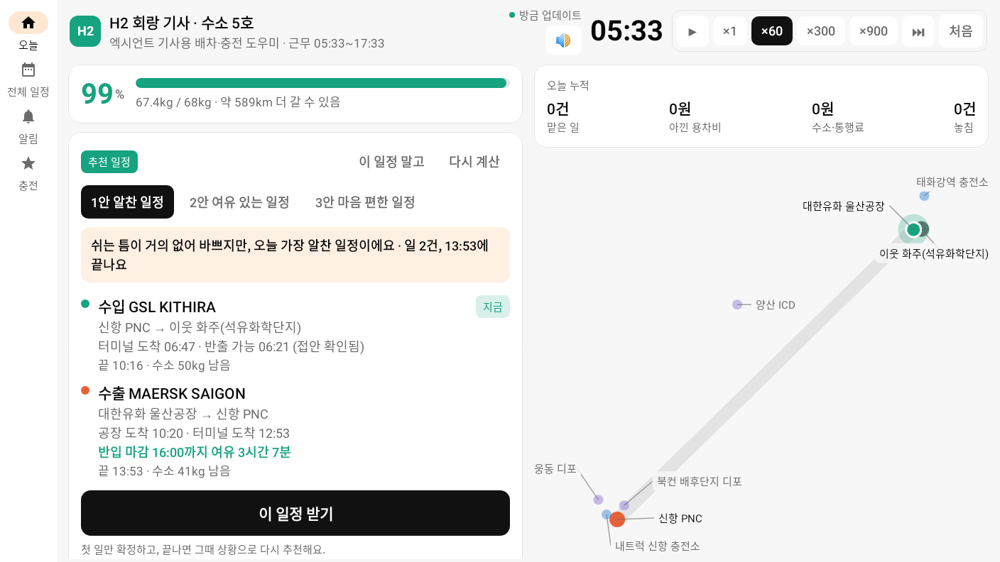
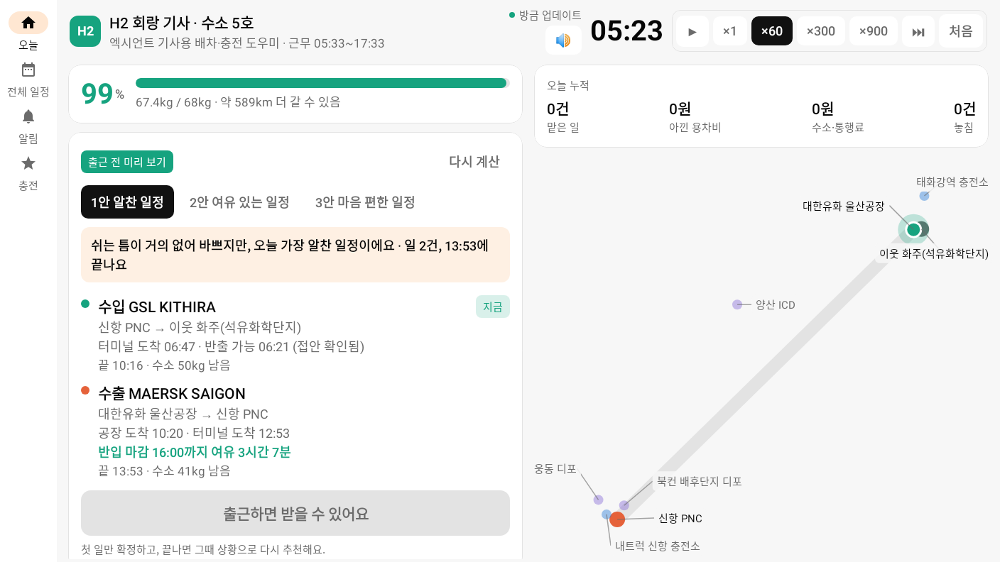
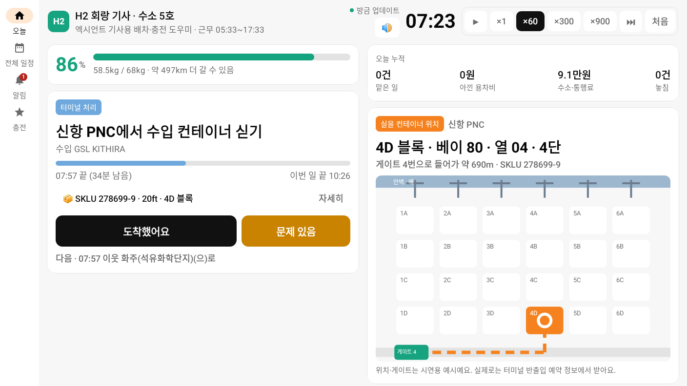
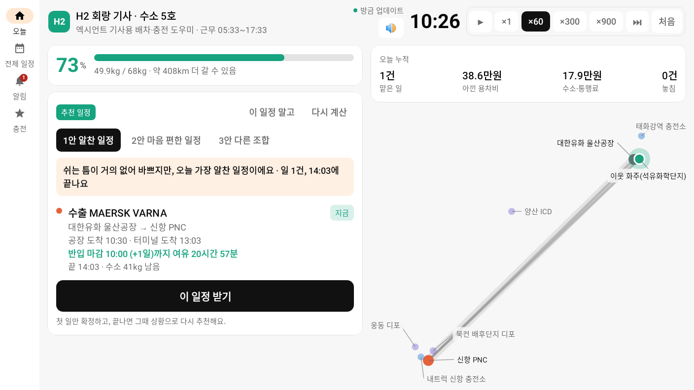

# H2 회랑 기사

**엑시언트 기사용 배차·충전 도우미: 현대 엑시언트 수소전기 트럭 기사가 운전석에서 쓰는 업무·충전 앱 (플레오스 Connect용)**

첫 적용 대상은 울산 화주 공장과 부산신항 사이를 오가는 엑시언트 수소전기 트랙터 기사입니다. 기사에게 지금 받을 수 있는 컨테이너 일감 1~3개와 수소 충전을 묶은 일정을 추천합니다.
배 접안 지연 확률, 수소 잔량, 반입 마감, 근무시간, 충전소·디포 운영시간을 **돈으로 환산해** 비교하고, 상황이 바뀌면 다시 계산합니다.



## 무엇을 하나

| 화면 | 내용 |
|---|---|
| 오늘 | 수소 잔량, 성격이 다른 추천 1~3안(알찬·여유 있는·마음 편한 일정, 기사 입장 한 줄 설명, 반입 마감까지 여유), "이 일정 말고"(사유별로 다시 추천·배차 담당자 전화), 운전 중에는 다음 할 일·남은 거리·도착 시각만 크게, 멈춰서 하는 일에는 [도착/끝났어요] [문제 있음] 두 버튼, 컨테이너 정보(접어 둠), 터미널 안에서는 지도 대신 컨테이너 위치(블록·베이·열·단과 게이트에서 가는 길), 2시간 운전 휴게 안내, 상·하차 끝에 사진·전자 인수증 서명, 순정 내비로 길안내, 실제 도로 지도 |
| 전체 일정 | 지난·지금·확정된 구간 |
| 알림 | 배 접안 지연, 접안 확인, 추천에 있던 일감이 다른 트럭에 배정됨, 내가 배차 담당자에게 보낸 것 |
| 충전 | 충전소에 있는 동안은 지도 대신 충전 화면(내 차례·문 여는 시각, 찬 양·남은 시간, 끝나면 음성으로 불러 드림, 다음 일 미리 보기, 오늘 번 돈, 근처 편의시설·자동 정산은 예시). 충전 탭에는 차량 종류·남은 연료, 오늘 충전, 충전소 지금 운영 여부·대기 대수·예약 요청, 운영시간·단가 |
| 맨 위 | 마지막 업데이트 시각, 음성 안내 켜기/끄기, 음성 명령(기기에 음성 인식 서비스가 있을 때만 보임: "받기", "도착", "끝났어요", "문제 있어") |

- 추천 계산은 **앱 안에서 직접** 합니다(인터넷 없이도 동작). 일감 1~3개 + 충전 0~1회 조합을 만들고, 수소 15%·마감·근무시간(30분 여유)·운영시간으로 거른 뒤
  `점수 = 운임 − 수소비 − 통행료 − 대기·노는 시간(시간당 4만원) − 수입 늦음 − 수출 놓칠 위험(100만원 × 확률) − 초과근무` 로 고릅니다.
- 수출 "배 놓칠 확률"은 배마다 학습 모델(XGBoost 분위수 + 구간 보정)이 낸 접안 지연 시나리오 100개에서 계산합니다.
- 첫 일만 확정하고, 끝나면 그때 상황으로 다시 추천합니다.
- 화면은 트럭 기사 기준으로 단순하게: 평소에는 큰 버튼 두세 개만 보이고, 자세한 내용은 눌러야 펼쳐집니다. 새 추천·일정 받기·접안 지연 같은 알림은 음성(안드로이드 TTS, 한국어)으로도 알려 줍니다.
- **시연용 예시 값**: 컨테이너 번호·무게·게이트·반출입 예약, 충전소 대기 대수·예약은 실제 자료가 아니라 시연용으로 만든 값입니다(화면에도 "예시"로 표시). 도착·완료·문제 신고·전화는 시연에서는 알림 목록에 기록만 남깁니다.
- 지금 버전은 **2026-07-16 하루 시연**입니다(위쪽 ▶ ×60 ×300 ⏭ 버튼으로 하루를 빨리 돌림). 트럭은 울산 공장 소속 "수소 5호"이고, 같은 회사 다른 4대가 일감을 가져가는 시각은 배차 시뮬레이션 기록을 따릅니다.

## 누구를 위한 앱인가

- **대상:** 1차는 현대 엑시언트 수소전기 트럭(트랙터) 기사, 이어서 현대 상용 전기 트럭·일반 화물 기사. 엑시언트에 플레오스 Connect가 들어간다는 것은 이 기획의 가정입니다. 하루에 여러 건의 일감을 받고, 충전소·터미널 대기를 직접 맞춰야 하는 운송 기사가 운전석에서 씁니다.
- **왜 차 안에서:** 일정 추천은 차량의 실시간 연료 잔량·위치·주행 여부가 있어야 정확하고, 운전 중에는 큰 글씨·두 개 버튼·음성으로만 다뤄야 해서 휴대폰보다 차량 화면이 맞습니다.
- **넓히는 순서:** ① 엑시언트 수소전기 트랙터(지금 시연) → ② 전기 트럭(같은 화면에서 배터리 kWh·급속충전기로 바뀜, 엔진은 연료 단위만 바꾸면 됨) → ③ 일반 컨테이너·화물 기사(충전 제약 없이 배차·터미널 기능만).

## 플레오스 SDK·API 활용

| 기능 | 지금(구현됨) | 플레오스 SDK로 바꿀 자리 |
|---|---|---|
| 연료 잔량·주행 여부 | `vehicle/VehicleData.kt` 인터페이스, 시연 값 | Vehicle SDK(`PleosVehicleData`, 코드에 자리 마련) |
| 길안내 | 표준 내비 Intent로 순정 내비 열기 | NaviHelper SDK(경유지·도착 이벤트로 다음 단계 자동 진행) |
| 음성 | 안드로이드 TTS 안내, SpeechRecognizer 음성 명령 | 플레오스 음성 SDK |
| 화면 | 차량 가로 화면(2560×1440) 기준, 운전 중 주의 분산을 줄인 큰 글씨·두 버튼 | 그대로 사용 |

플레오스 SDK 저장소(nexus-playground.pleos.ai)는 개발 환경에서 받을 수 없어, SDK가 들어갈 자리는 인터페이스로 분리해 두고 지금은 표준 안드로이드 API로 동작합니다.

## APK

- 위치: [`apk/빅히어로_H2회랑기사_release.apk`](apk/) (release 빌드, x86_64·arm64-v8a)
- 설치: `adb install -r apk/빅히어로_H2회랑기사_release.apk`
- 실행: 앱 목록의 **H2 회랑 기사**, 또는 `adb shell am start -n kr.bighero.h2.driver/.MainActivity`
- 시연 순서: ⏭(출근) → 추천 1안 확인 → **이 일정 받기** → ▶ 또는 ⏭로 진행 → 일이 끝나면 새 추천

## 개발·테스트 환경

| 항목 | 값 |
|---|---|
| 에뮬레이터 | **Pleos Connect v2.1.0** 시스템 이미지 (`system-images;android-34;pleos_car_emulator;x86_64`, 42dot, android-automotive, rev 2) |
| 화면 규격 | **2560×1440, 160dpi**, 가로 (AVD `PleosConnect`, RAM 4GB, GPU host) |
| 앱 | Kotlin 2.1, Jetpack Compose, minSdk 28 / targetSdk 35, Gradle 8.14.3, AGP 8.10.1, JDK 17~21 (Java 25 불가) |
| 지도 | MapLibre Android 11.13.5 + OpenFreeMap 타일(키 필요 없음, © OpenStreetMap). 경로선은 OSRM으로 미리 받은 `assets/routes.json` |
| 길안내 | 표준 내비 인텐트(`android.intent.action.NAVIGATE`, `geo:`)로 플레오스 순정 내비 실행 (에뮬레이터에서 확인) |
| 필요한 설정 | 지도 타일용 인터넷 연결(에뮬레이터 기본 켜짐). API 키·계정 필요 없음 |

플레오스 Connect 에뮬레이터 설치는 SDK 저장소 `https://nexus-playground.pleos.ai/repository/raw-releases/connect-avd/2.x/crp-sys-img.xml` 을 쓰며,
Windows에서 한 번에 설치하는 스크립트는 [`android/tools/setup-pleos.ps1`](android/tools/setup-pleos.ps1), 자세한 순서는 [`android/다른 컴퓨터에서 이어서 하기.md`](android/다른%20컴퓨터에서%20이어서%20하기.md)에 있습니다.

## 소스에서 빌드·실행

```bash
cd android
./gradlew :core:test                 # 추천 엔진이 원래 시뮬레이터(파이썬)와 같은 답을 내는지(정답 5개 상황, 1원 단위) + 하루 자동 진행
./gradlew :app:testDebugUnitTest     # 에뮬레이터 없이 화면을 그려 app/build/screens/*.png 로 저장(차량 가로·플레오스 2560×1440·휴대폰)
./gradlew :app:assembleRelease       # APK: app/build/outputs/apk/release/app-release.apk
adb install -r app/build/outputs/apk/release/app-release.apk
```

Windows + 플레오스 에뮬레이터에서는 `powershell -ExecutionPolicy Bypass -File android\tools\h2-build.ps1` 한 줄로 빌드·설치·실행·화면 캡처까지 합니다.
안드로이드 스튜디오에서는 `android/` 폴더를 엽니다.

## 구조

```
android/
  core/   순수 Kotlin 계산 엔진: 자료 읽기, World(주행시간·운영시간·빈 컨테이너), Planner(추천), DaySim(하루 진행기)
  app/    Compose 화면(넓은 차량 화면 2단 + 왼쪽 탭, 휴대폰 1단 + 아래 탭), 지도(NaviMap), 차량 값·내비 연결부(vehicle/)
  app/src/main/assets/   day_2026-07-16.json(하루 자료), routes.json(실제 도로 경로)
scripts/  app_routes.py(도로 경로 받기), make_video.py(시연 영상 만들기)
docs/screens/  화면 캡처
apk/      release APK
```

- 추천 엔진은 **공지된 값 + 지연 시나리오 + 이미 일어난 접안**만 봅니다. 실제 접안·반출 시각(정답)은 자료의 `truth`에 따로 두고 하루 진행기만 읽습니다.
- 차량 값(수소 잔량·주행 여부)은 `vehicle/VehicleData.kt` 인터페이스로 분리해, 플레오스 Vehicle SDK로 바꿔 끼울 수 있게 했습니다. 길안내도 `vehicle/Navi.kt`에서 NaviHelper SDK로 바꿀 자리를 마련했습니다.

## 다음 단계

- 플레오스 SDK: Vehicle(수소 잔량·주행 상태), NaviHelper(경로 요청·충전소 경유지·도착 이벤트로 다음 단계 자동 진행), FusedLocation(위치), TTS/STT(지금은 안드로이드 기본 TTS·음성 인식 사용)
- 실시간 연결: 배차 서버(여러 트럭 함께 조정), 부산항 선석 정보, 수소충전소 실시간 대기 대수(한국석유관리원), 컨테이너·반출입 예약(터미널), 사진·서명 업로드

## 화면

| 출근 전 | 추천 |
|---|---|
|  |  |
| **진행 중** | **다음 추천** |
|  |  |

(위 캡처는 에뮬레이터 없이 그린 화면이라 지도 자리가 간이 지도입니다. 실제 앱에서는 도로 지도가 나옵니다.)
